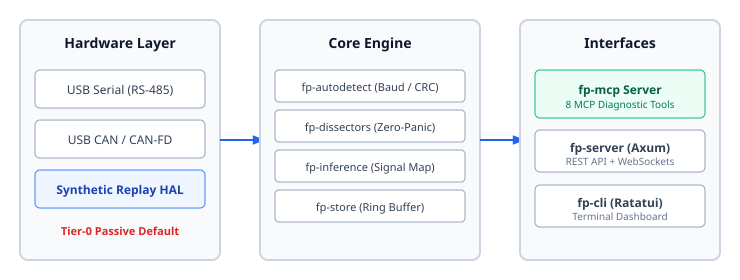

# 01. System Overview

> **Topic:** Purpose and architecture of the field-probe system.

---

## 1. Description

The `field-probe` system is a cross-platform diagnostic engine written in Rust.  
The system identifies industrial communication networks automatically.  
Engineers connect a standard USB adapter to an undocumented cabinet or vehicle harness.  
The engine detects baud rate, parity, protocol, and node topology.  
The engine operates in listen-only mode by default.  
It does not transmit data unless authorized.

---

## 2. System Architecture

The system consists of three functional sections:
1. **Hardware Layer:** Interfaces with physical serial and CAN adapters, or synthetic replay streams.
2. **Core Analysis Engine:** Detects framing, parses messages, infers data types, and buffers events.
3. **User and Agent Interfaces:** Exposes telemetry to human engineers and autonomous AI agents.



---

## 3. Crate Breakdown

The workspace contains 10 decoupled Rust crates under `crates/`:

| Crate | Primary Role | Safety Invariant |
|---|---|---|
| `fp-core` | Fundamental domain models and error types | SafetyTier defaults to `PassiveListenOnly` |
| `fp-hal` | Hardware abstraction and synthetic replay interface | Blocks outbound frames when in Tier-0 |
| `fp-store` | In-memory circular ring buffer for event capture | Bounded memory allocation |
| `fp-autodetect` | Baud-rate hunter and sliding-window CRC scanner | Operates strictly passively |
| `fp-dissectors` | Protocol parsers and standards compliance auditor | Zero-panic parsing of noisy line bytes |
| `fp-crypto` | Security key manager and Shannon entropy calculator | Flags encrypted payloads (&gt;7.2 bits/byte) |
| `fp-inference` | Multi-representation decoder and signal catalog | Evaluates temporal plausibility |
| `fp-mcp` | Model Context Protocol server exposing 8 tools | Strict JSON schemas for AI agents |
| `fp-server` | Axum HTTP REST and WebSocket telemetry daemon | Real-time event streaming |
| `fp-cli` | Ratatui terminal dashboard and CLI binary | Standalone executable |

---

## 4. Verification Procedure

Run the test suite to verify workspace integrity:

```bash
cargo build --workspace
cargo test --workspace
cargo clippy --workspace -- -D warnings
```
