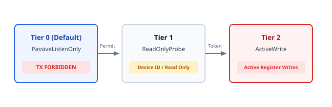

# 02. Safety Invariants (Zero-TX Default)

> **Topic:** Mandatory safety rules to prevent industrial network disturbance.

---

## 1. Description

Transmitting unexpected data on an active bus can disrupt machinery.  
Transmitting at an incorrect baud rate causes CAN Bus-Off faults.  
Transmitting out of synchronization causes Modbus packet collisions.  
To prevent equipment damage, the system enforces a strict 3-tier safety model.

---

## 2. Safety State Machine

All adapters power on in `SafetyTier::PassiveListenOnly` (Tier 0).  
The system rejects all transmission attempts while in Tier 0.

---

## 3. The Three Safety Tiers

### 3.1 Tier 0: Passive Listen-Only (Default)
- The transceiver Driver Enable line remains de-asserted.
- CAN controllers operate in Silent / Listen-Only mode.
- Transmitting dominant CAN bits or serial bytes is forbidden.
- The engine reconstructs bus topology from passive traffic alone.

### 3.2 Tier 1: Safe Read-Only Discovery
- The operator or authenticated AI agent presents a valid `SafetyPermit`.
- The engine confirms no conflicting master is active on the bus.
- The engine executes non-destructive read operations:
  - Modbus Function Code `0x2B`/`0x0E` (Read Device Identification).
  - Modbus Function Code `0x01`..`0x04` register reads.
  - CAN UDS Service `0x22` (ReadDataByIdentifier).

### 3.3 Tier 2: Active Diagnostic and Write Mode
- Requires an explicit cryptographic token and elevated permit.
- Allows register modification (Modbus FC `0x06`/`0x10`) or CAN frame injection.

---

## 4. Permit Validation Rules

Before transmitting any frame, the hardware layer validates the permit:
1. Verify the current timestamp is before the permit expiration timestamp.
2. Confirm the permit granted tier is equal to or greater than the required tier.
3. Confirm the caller identity matches the authorized session.
4. If the interface is in Tier 0, immediately return `HalError::SafetyViolation`.
