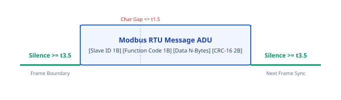

# 03. Protocol Timing & Framing Specifications

> **Topic:** Bus timing tolerances, CRC verification, and serial framing heuristics.

---

## 1. Modbus Serial (RS-485 / RS-232) Timing

### 1.1 Silence Intervals ($t_{1.5}$ and $t_{3.5}$)

In Modbus RTU, message frames require silent intervals of at least **3.5 character times** ($t_{3.5}$).  
Individual characters inside a frame must not exceed **1.5 character times** of separation ($t_{1.5}$).



#### Calculation Formulas

A Modbus character contains 1 start bit + 8 data bits + 1 parity bit + 1 stop bit = **11 bits total**.

$$\text{Bit Time} = \frac{1}{\text{Baud Rate}}$$
$$\text{Character Time} = \frac{11}{\text{Baud Rate}}$$

| Baud Rate (bps) | Char Time ($\mu$s) | Inter-Char $t_{1.5}$ ($\mu$s) | Inter-Frame $t_{3.5}$ ($\mu$s) | Mode |
|---|---|---|---|---|
| **2400** | 4583.3 | 6875.0 | 16041.7 | Calculated |
| **4800** | 2291.7 | 3375.0 | 8020.8 | Calculated |
| **9600** | 1145.8 | 1718.8 | 4010.4 | Calculated |
| **19200** | 572.9 | 859.4 | 2005.2 | Calculated |
| **38400** | 286.5 | **750.0 (Fixed)** | **1750.0 (Fixed)** | Fixed Standard |
| **57600** | 191.0 | **750.0 (Fixed)** | **1750.0 (Fixed)** | Fixed Standard |
| **115200** | 95.5 | **750.0 (Fixed)** | **1750.0 (Fixed)** | Fixed Standard |
| **230400** | 47.7 | **750.0 (Fixed)** | **1750.0 (Fixed)** | Fixed Standard |

> **Rule:** For baud rates above 19200 bps, use the fixed constants $t_{1.5} = 750\ \mu\text{s}$ and $t_{3.5} = 1750\ \mu\text{s}$.

---

## 2. Checksum and CRC Algorithms

The engine verifies frame integrity with an 8-algorithm sliding probe.


### 2.1 Additive Sum-8 Modulo 256
- **Algorithm:** Sum all payload bytes modulo 256: `sum(bytes) & 0xFF`.
- **Application:** Basic industrial telemetry sensors and proprietary RS-485 serial controllers.
- **Trailer Width:** 1 byte.

### 2.2 Modbus ASCII LRC / Two's Complement-8
- **Algorithm:** Sum all payload bytes modulo 256. Compute the two's complement: `((!sum) + 1) & 0xFF`.
- **Framing:** Frame starts with `:` (`0x3A`) and ends with `\r\n` (`0x0D 0x0A`).
- **Trailer Width:** 1 byte (or 2 ASCII hex characters).

### 2.3 XOR-8 Longitudinal Redundancy Check (LRC)
- **Algorithm:** Bitwise XOR accumulator over all payload bytes: `xor_acc ^= byte`.
- **Application:** Legacy automation buses, bar-code readers, and NMEA-0183 serial streams.
- **Trailer Width:** 1 byte.

### 2.4 BACnet MS/TP Header CRC-8
- **Polynomial:** $X^8 + X^7 + X^4 + X^3 + X + 1$ (`0x11D`), reflected: `0x8C`.
- **Initial Value:** `0xFF`. Invert at completion (`!crc`).
- **Preamble:** Preamble bytes are `0x55 0xFF`.
- **Trailer Width:** 1 byte.

### 2.5 Modbus RTU CRC-16
- **Polynomial:** $X^{16} + X^{15} + X^2 + 1$ (`0x8005`), reflected to `0xA001`.
- **Initial Value:** `0xFFFF`.
- **Byte Order:** Little-Endian (low byte transmitted first, then high byte).
- **Trailer Width:** 2 bytes.

### 2.6 DNP3 Data Link CRC-16 (IEEE 1815)
- **Polynomial:** Reflected polynomial `0xA6BC` (normal `0x3D65`).
- **Initial Value:** `0x0000`. Invert at completion (`!crc`).
- **Byte Order:** Little-Endian (low byte first).
- **Trailer Width:** 2 bytes (appended after header and after every 16 bytes of payload).

### 2.7 CRC-16-CCITT Big-Endian
- **Polynomial:** $X^{16} + X^{12} + X^5 + 1$ (`0x1021`).
- **Initial Value:** `0xFFFF`.
- **Byte Order:** Big-Endian (high byte transmitted first).
- **Trailer Width:** 2 bytes.

### 2.8 CRC-16-CCITT Little-Endian (Kermit / X.25)
- **Polynomial:** Reflected polynomial `0x8408`.
- **Initial Value:** `0xFFFF`.
- **Byte Order:** Little-Endian (low byte transmitted first).
- **Trailer Width:** 2 bytes.

### 2.9 SAE J1708 Two's Complement Checksum
- **Algorithm:** Compute the two's complement of the arithmetic sum: `((!sum) + 1) & 0xFF`.
- **Zero-Sum Rule:** Summing all frame bytes plus the checksum modulo 256 yields zero: `sum(frame) % 256 == 0`.
- **Application:** Heavy-duty diesel commercial vehicles and off-highway powertrain controllers.
- **Trailer Width:** 1 byte.

### 2.10 PROFIBUS DP Frame Check Sequence (FCS)
- **Algorithm:** Arithmetic sum of all bytes between delimiters: `sum(bytes) & 0xFF`.
- **Application:** Factory field devices and Siemens PLC motor starters over RS-485.
- **Trailer Width:** 1 byte (followed by end delimiter `0x16`).

### 2.11 KNX TP1 Inverted Longitudinal Parity
- **Algorithm:** Bitwise XOR accumulation over all octets, inverted: `0xFF ^ fold(bytes, XOR)`.
- **Application:** Commercial building management and smart lighting controllers.
- **Trailer Width:** 1 byte.

---

## 3. CAN Bus Bit-Timing and Protocol Heuristics

### 3.1 Bit-Timing Formulas
A nominal CAN bit consists of four segments:

$$\text{Nominal Bit Time} = T_{\text{Sync\_Seg}} + T_{\text{Prop\_Seg}} + T_{\text{Phase\_Seg1}} + T_{\text{Phase\_Seg2}}$$

$$\text{Sample Point (\%)} = \frac{T_{\text{Sync\_Seg}} + T_{\text{Prop\_Seg}} + T_{\text{Phase\_Seg1}}}{\text{Nominal Bit Time}} \times 100\%$$

- **Standard Sample Point:** 87.5% for CAN 2.0 and J1939.

### 3.2 Protocol Identification Matrix

| Protocol | CAN ID Format | Identification Signature | Typical Bitrate |
|---|---|---|---|
| **SAE J1939** | 29-bit Extended | PGN located in bits 8..25 (e.g., `0xF004` EEC1, `0xFECA` DM1) | 250 kbps, 500 kbps |
| **NMEA 2000** | 29-bit Extended | Fast-Packet PGNs `127488` (Rapid), `127489` (Dynamic), `127505` (Fluid) | 250 kbps |
| **ISOBUS (ISO 11783)**| 29-bit Extended | Extended Transport Protocol `ETP.CM` (PGN 51200), `ETP.DT` (PGN 50944) | 250 kbps |
| **DeviceNet (ODVA)** | 11-bit Standard | Group 1 (`0x000..0x3FF`), Group 2 (`0x400..0x5FF`), Predefined Master/Slave | 125, 250, 500 kbps |
| **CANopen** | 11-bit Standard | COB-IDs: `0x000` NMT, `0x080` SYNC, `0x700 + NodeID` Heartbeat, SDO `0x580/0x600` | 125 kbps to 1 Mbps |
| **AUTOSAR CAN NM** | 11-bit / 29-bit | Identifier base `0x400..0x6FF`, Control Bit Vector (CBV) in byte 1 | 500 kbps |
| **ISO-TP / UDS** | 11-bit Standard | Diagnostic IDs `0x7DF`, `0x7E0..0x7EF`, PCI byte 0 `0x0..0x3` | 500 kbps |

---

## 4. Universal Process Transmitter & Fieldbus Serial Heuristics

The `fp-autodetect` engine incorporates dedicated sliding-window pattern scanners for non-Modbus industrial serial streams:

### 4.1 Siemens PROFIBUS DP Serial Framing
PROFIBUS DP networks use three primary start delimiters (SD):
- **SD1 (`0x10`):** Fixed 6-byte control frame (`0x10 DA SA FC FCS 0x16`).
- **SD2 (`0x68`):** Variable-length data telegram (`0x68 LE LEr 0x68 DA SA FC [PDU] FCS 0x16`). The length field (`LE`) must match the repeated length (`LEr`).
- **SD3 (`0xA2`):** Fixed 5-byte data frame with trailing FCS and `0x16`.
- **Short Ack (`0xE5`):** Single character response confirming receipt.

### 4.2 Highway Addressable Remote Transducer (HART FSK / Bell 202)
HART networks modulate 1200 baud Bell 202 frequency-shift keying over 4–20 mA current loops:
- **Preamble:** Three or more `0xFF` synchronizing bytes.
- **Delimiter:** Primary/Secondary master or slave delimiter (`0x02`, `0x82`, `0x06`, `0x86`).
- **Address:** 1-byte short polling address (`0..15`) or 5-byte unique IEEE MAC address.
- **Payload & Checksum:** Includes command byte, status byte count, data, and longitudinal XOR checksum.

### 4.3 Meter-Bus (EN 13757 M-Bus) Utility Telemetry
M-Bus connects heat, water, gas, and electric meters over 2-wire loops:
- **Short Frame (`0x10`):** 5-byte query (`0x10 C A FCS 0x16`).
- **Control Frame (`0x68 03 03`):** 9-byte control command.
- **Long Frame (`0x68 L L 0x68`):** Variable-length data telegram with 12-byte fixed header:
  - BCD-encoded identification number (e.g. `12345678`).
  - 2-byte encoded manufacturer identifier (e.g. `KAM` for Kamstrup).
  - Medium classification (Heat, Water, Electricity, Gas).

### 4.4 KNX TP1 Twisted-Pair Building Automation
KNX TP1 operates at 9600 bps asynchronous balanced baseband:
- **Control Byte (`0xBC`):** Designates standard frame, normal priority, and unrepeated telegram.
- **Addressing:** Source individual address (`Area.Line.Device`) and destination group address (`Main/Middle/Sub`).
- **APCI:** Dissects GroupValueRead, GroupValueResponse, and GroupValueWrite commands.

### 4.5 SAE J1708 Heavy-Duty Diesel Serial
SAE J1708 operates at 9600 bps over differential RS-485 transceivers:
- **Inter-Frame Silence:** Bus idle of at least 2 character bit times.
- **Message Identification (MID):** First byte identifies controller (128 = Engine #1, 130 = Transmission, 136 = ABS).
- **Zero-Sum Checksum:** Validates with two's complement modulo 256.

---

## 5. USB Adapter VID/PID Fingerprint Matrix

| Adapter | USB VID | USB PID | Chipset |
|---|---|---|---|
| **FTDI Single Port** | `0x0403` | `0x6001` | FT232R / FT232RL |
| **FTDI Quad Port** | `0x0403` | `0x6011` | FT4232H |
| **Silicon Labs CP210x** | `0x10C4` | `0xEA60` | CP2102 / CP2104 |
| **WCH CH340** | `0x1A86` | `0x7523` | CH340G |
| **PEAK PCAN-USB** | `0x0C72` | `0x000C` | SJA1000 / PCAN |
| **Kvaser Leaf Light** | `0x0BFD` | `0x0100`..`0x01FF` | Kvaser Hydra |
| **GS_USB / CANable** | `0x1D50` | `0x606F` | STM32 CandleLight |

---

## 6. Protocol Verification & Compliance Methodology

Field verification uses deterministic test vectors and recorded bus captures to ensure compliance:

### 6.1 Deterministic Replay Testing
Execute automated test suites against synthetic `.pcap` and `.candump` captures to verify timing precision:
```bash
cargo test -p fp-autodetect
cargo test -p fp-dissectors
```

### 6.2 Live Field Audit
Audit serial line timing and inter-frame intervals directly from the command line:
```bash
cargo run -p fp-cli -- audit
```

### 6.3 PCAP-NG Multi-Interface LinkType Demultiplexing
PCAP-NG captures can record different industrial networks in one trace file.  
The replay engine parses Interface Description Blocks (IDBs) to map interfaces to exact protocols:
- **LinkType 227 (`LINKTYPE_CAN_SOCKETCAN`):** Handled as Linux SocketCAN frames with standard or extended CAN IDs, DLC, and payload.
- **LinkType 147 (`LINKTYPE_USER0`), 250 (`LINKTYPE_RTAC_SERIAL`), 274 (`LINKTYPE_MODBUS`):** Handled as serial byte chunks with microsecond inter-arrival timestamps.

This interface tracking prevents serial payloads from being misparsed as 8-byte CAN frames.

---

## 7. Unknown Protocol Sequence Framer (Netzob Heuristics)

When proprietary or uncataloged serial protocols operate on the bus, `fp-autodetect::UnknownFramer` applies sequence alignment and statistical column entropy analysis:

### 7.1 Silence-Delimited Clustering (`cluster_by_silence`)

Partitions timestamped raw byte slices into distinct frame candidates.  
When the time delta between two consecutive byte chunks exceeds the configured threshold ($t_{\text{silence}}$, e.g. 3.5 character times or custom interval), the framer demarcates a packet boundary.

### 7.2 Statistical Matrix Variance Analysis (`analyze_frame_matrix`)

The engine aligns detected frames into a two-dimensional byte matrix and computes statistical variance for each byte column position ($k$):

$$\text{Variance}_k = \frac{1}{N} \sum_{i=1}^{N} \left(\frac{\text{Byte}_{i,k}}{255.0} - \mu_k\right)^2$$

Columns are classified into distinct structural categories:
- **Static / Constant Columns ($\text{Variance} = 0.0$):**  
  Identifies unchanging bytes. These represent candidate protocol preambles, sync words (e.g., `0x55 0xFF`), or fixed operation codes.
- **Low Variance Columns ($0.0 < \text{Variance} < 0.15$):**  
  Identifies incrementally changing bytes. These represent candidate packet sequence counters, rolling transaction IDs, or node addresses.
- **Dynamic Payload Columns ($\text{Variance} \ge 0.15$):**  
  Identifies high-entropy bytes. These represent analog sensor measurements, variable payloads, or cryptographic/CRC checksums.

### 7.3 Raw Contiguous Stream Inference (`infer_from_raw_stream`)

When hardware timestamp markers are unavailable, `infer_from_raw_stream` searches a contiguous byte buffer for repeating delimiters (e.g. `\r\n`, `0x7E`, `0x55`) or repeating fixed-length stride patterns to hypothesize frame boundaries.

