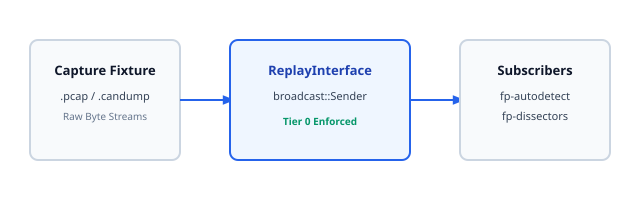

# 04. Hardware Layer (fp-hal)

> **Topic:** The Hardware Abstraction Layer and deterministic synthetic replay interface.

---

## 1. Description

The `fp-hal` crate provides a unified async interface for bus hardware.  
It supports physical serial ports, native CAN sockets, and recorded files.  
Every interface enforces the `SafetyTier::PassiveListenOnly` invariant on startup.

---

## 2. Replay Architecture

The `ReplayInterface` reads synthetic `.pcap` and `.candump` captures.  
It broadcasts events through an async channel at microsecond intervals.  
This allows testing algorithms in CI without physical adapters.



---

## 3. The BusInterface Trait

All hardware drivers implement the `BusInterface` trait:

```rust
#[async_trait]
pub trait BusInterface: Send + Sync {
    fn capabilities(&self) -> AdapterCapabilities;
    fn current_safety_tier(&self) -> SafetyTier;
    async fn set_link_params(&mut self, params: &LinkParams) -> Result<(), HalError>;
    async fn set_safety_tier(&mut self, tier: SafetyTier) -> Result<(), HalError>;
    fn subscribe_rx(&self) -> broadcast::Receiver<RawBusEvent>;
    async fn transmit(&mut self, frame: OutboundFrame, permit: &SafetyPermit) -> Result<(), HalError>;
}
```

---

## 4. Hardware Drivers and Adapters

`fp-hal` includes production drivers implementing `BusInterface`:

- **SLCAN Driver (`SlcanDriver`):**  
  Communicates with CAN-to-USB adapters using the ASCII SLCAN protocol (Lawicel / CANable / Candlelight).  
  Initializes in Tier-0 listen-only mode using commands `["C\r", "S6\r", "L\r"]`.  
  Supports standard 11-bit (`t`), extended 29-bit (`T`), RTR (`r`/`R`), and CAN-FD (`d`/`D`/`b`/`B`) frames.

- **Serial Driver (`SerialDriver`):**  
  Interfaces with RS-485/RS-232 serial transceivers.  
  Measures microsecond inter-chunk arrival gaps with `Instant` timestamps to detect Modbus 3.5-character silent intervals.  
  Enforces hardware transceiver gating by holding RTS/DTR de-asserted in listen-only mode.

- **SocketCAN Driver (`SocketCanDriver`):**  
  Interfaces with Linux native `can0`/`vcan0` devices.  
  Enforces kernel listen-only socket flags and translates Linux `<linux/can/error.h>` bitmasks into structured `BusErrorFlags`.

- **Unified Dongle Enumeration (`fp_hal::enumerate_dongles`):**  
  Scans operating system serial and CAN interfaces. Maps USB vendor/product IDs (VID/PID) to industrial interface chips (FTDI FT232, CH340, CP2102, CANable STM32, GS-USB) and reports hardware listen-only capabilities.

---

## 5. Transmission Safety Rules

1. If the current tier is `PassiveListenOnly`, `transmit()` must fail immediately.
2. If the permit is expired, `transmit()` must fail immediately.
3. If the permit scope does not match the target, `transmit()` must fail.
4. Valid transmissions emit an event with `Direction::Tx` on the broadcast stream.
