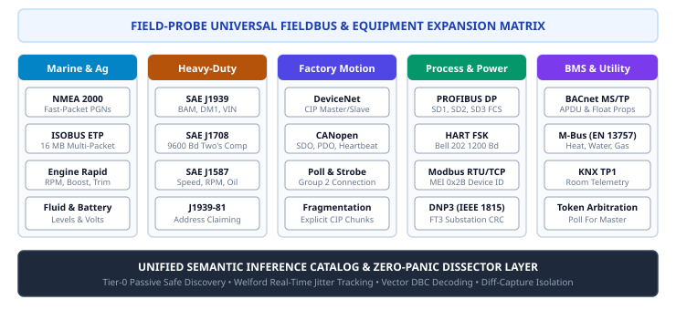

# 05. Dissectors and Compliance (fp-dissectors)

> **Topic:** Zero-panic protocol dissectors, multi-packet transport reassembly, and standards compliance auditing.

---

## 1. System Overview

The `fp-dissectors` crate parses raw byte streams and CAN frames from untrusted, noisy physical lines.  
It provides structured dissection for:
- **Modbus RTU & Modbus TCP:** Including Encapsulated Interface Transport (MEI FC `0x2B` / `0x0E`) for device identification.
- **IEEE 1815 (DNP3):** Data Link, Transport, and Application layers with FT3 CRC-16 verification for substation RS-485 networks.
- **ISO 15765-2 (ISO-TP):** Multi-frame CAN transport reassembly with sequence number checking and timeout eviction.
- **ISO 14229 (UDS):** Unified Diagnostic Services session control, data identifier queries, security access, and negative response auditing.
- **SAE J1939:** Single-frame PGN extraction plus multi-packet Transport Protocol (BAM & CMDT) reassembly for VIN, Component ID, and DM1 Active DTCs.
- **NMEA 2000 & ISOBUS (ISO 11783):** Fast-Packet marine engine parameters and Extended Transport Protocol (`ETP.CM` / `ETP.DT`) up to 16 MB.
- **ODVA DeviceNet:** 11-bit CAN ID Group 1–4 message grouping, Predefined Master/Slave I/O polling, and fragmented CIP explicit messaging.
- **SAE J1708 / J1587:** Heavy-duty diesel serial framing, Message Identification (MID), and physical PID telemetry.
- **CANopen:** NMT network management state transitions, Heartbeat, and SDO expedited upload/download protocols.
- **Commercial HVAC & Utility:** BACnet MS/TP APDU property access, Meter-Bus (EN 13757 M-Bus) utility meters, and KNX TP1 building automation.

---

## 2. Zero-Panic Rule

Industrial line noise creates truncated and malformed byte sequences.  
A dissector must never panic during execution.  
Engineers must enforce these rules in all parser paths:
- Never use `.unwrap()` or `.expect()` in production paths.
- Never use direct slice indexing `buf[i..j]`.
- Always use `nom` combinators or checked slice operations (`split_at_checked`, `.get()`).
- Verify framing lengths and byte counts before parsing inner payloads.

---

## 3. Sliding-Window CRC Scanner

The scanner searches a noisy serial byte buffer for valid Modbus frames:

1. Test candidate sub-slices of length 4 to 256 bytes.
2. Verify the trailing 2 bytes against the computed Modbus RTU CRC-16.
3. When a match is found, extract the Application Data Unit (ADU).
4. Slide the window by one byte if the checksum fails.

---

## 4. ISO 15765-2 (ISO-TP) Transport Reassembler

Automotive and industrial CAN frames are limited to 8 payload bytes in classic CAN and 64 bytes in CAN-FD. Large diagnostic messages use ISO 15765-2 transport reassembly:

| PCI Frame Type | Nibble | Function | Payload Capacity |
| :--- | :--- | :--- | :--- |
| **Single Frame (SF)** | `0x0_` | Unfragmented message (Classical CAN: 1 to 7 bytes; CAN-FD: `0x00` escape up to 62 bytes) | 1 to 62 bytes |
| **First Frame (FF)** | `0x1_` | Initiates segmented transfer; announces 12-bit length (`0x1N`) or CAN-FD 32-bit length (`0x10 0x00`) | Up to $2^{32}-1$ bytes |
| **Consecutive Frame (CF)** | `0x2_` | Transfers payload chunks with sequence counter (`0..15`) | Up to 63 bytes per frame |
| **Flow Control (FC)** | `0x3_` | Flow status (`CTS = 0`, `Wait = 1`, `Overflow = 2`), Block Size (`BS`), and Separation Time (`STmin`: ms or µs) | Protocol control |

The `IsoTpReassembler` manages per-CAN-ID assembly sessions across all four standard addressing schemas:
- **Normal 11-Bit:** Direct arbitration ID mapping (e.g., `0x7E0` request / `0x7E8` response).
- **Normal Fixed 29-Bit:** Priority (3-bit), Target Address / PS (8-bit), and Source Address / SA (8-bit). Supports Physical addressing (`0x18DA...`) and Functional broadcast (`0x18DB...`).
- **Extended 11-Bit:** Transmits Target Address (`N_TA`) in payload byte 0.
- **Mixed 29-Bit:** Transmits Address Extension (`N_AE`) in payload byte 0 with Format `0xCE` (`0x18CE...`).

---

## 5. ISO 14229 (UDS) Diagnostic Service Dissector

The UDS dissector parses reassembled ISO-TP payloads into structured diagnostic services:

- **Diagnostic Session Control (`0x10` / `0x50`):** Default, Programming, and Extended Diagnostic sessions with P2/P2* server timing parameters.
- **ECU Reset (`0x11`):** Hard reset, key-off-on reset, soft reset, and enable rapid power shutdown.
- **Clear Diagnostic Information (`0x14`):** Purges stored emission and manufacturer fault records.
- **Read DTC Information (`0x19` / `0x59`):** Extracts 3-byte DTCs (2-byte SAE code + 1-byte Failure Mode Indicator [FMI] / Fault Type Byte [FTB]) and 1-byte status mask (`testFailed`, `pending`, `confirmed`, `warningIndicator`).
- **Read & Write Data By Identifier (`0x22`, `0x2E`, `0x62`):** Extracts 16-bit DIDs with automatic name lookup across standard automotive DIDs (`0xF180` BootSoftwareIdentification, `0xF186` ActiveDiagnosticSession, `0xF187` SparePartNumber, `0xF189` SoftwareVersion, `0xF190` VIN).
- **Security Access (`0x27` / `0x67`):** Parses seed request and key send handshakes.
- **Input / Output Control (`0x2F` / `0x6F`):** Audits actuator overrides, short-term adjustments, and returns control to ECU.
- **Routine Control (`0x31` / `0x71`):** Monitors startRoutine (`0x01`), stopRoutine (`0x02`), and requestRoutineResults (`0x03`) across 16-bit Routine Identifiers (e.g., `0x0203` Check Memory, `0x0202` Erase Memory).
- **Firmware Flashing & Data Transfer (`0x34`–`0x37`):** Dissects RequestDownload (`0x34`), RequestUpload (`0x35`), TransferData (`0x36`) with block sequence counter auditing, and RequestTransferExit (`0x37`).
- **Tester Present (`0x3E` / `0x7E`):** Audits keep-alive signals and suppress-positive-response flags.
- **Negative Response (`0x7F`):** Identifies rejected Service ID (SID) and maps Negative Response Codes (NRC) such as `ConditionsNotCorrect` (`0x22`), `SecurityAccessDenied` (`0x33`), or `ServiceNotSupportedInActiveSession` (`0x7F`).

---

## 6. SAE J1979 / ISO 15031-5 (OBD-II) Dissector

The OBD-II engine provides automated decoding of vehicle powertrain diagnostics across Modes $01 through $0A:

- **Mode $01 (Show Current Data):** Translates raw PID bytes into scaled physical units:
  - `0x0C` Engine RPM: $\frac{A \times 256 + B}{4}\text{ rpm}$
  - `0x0D` Vehicle Speed: $A\text{ km/h}$
  - `0x05` Engine Coolant Temperature: $A - 40\text{ }^\circ\text{C}$
  - `0x0F` Intake Air Temperature: $A - 40\text{ }^\circ\text{C}$
  - `0x10` MAF Air Flow Rate: $\frac{A \times 256 + B}{100}\text{ g/s}$
  - `0x04` Calculated Engine Load / `0x11` Throttle Position: $\frac{A}{2.55}\text{ \%}$
  - `0x1F` Run Time Since Engine Start: $A \times 256 + B\text{ s}$
  - `0x42` Control Module Voltage: $\frac{A \times 256 + B}{1000}\text{ V}$
- **Mode $02 (Show Freeze Frame):** Captures snapshot PID records logged when a DTC triggered.
- **Mode $03 / $07 / $0A (DTC Extraction):** Parses 2-byte trouble codes into standard 5-character SAE J2012 codes (`P0300`, `U0100`, `C0035`, `B0001`):
  - Prefix determined by bits 7-6 (`00 = P` Powertrain, `01 = C` Chassis, `10 = B` Body, `11 = U` Network).
  - Code type determined by bits 5-4 (`0` or `2` = SAE Standard, `1` or `3` = Manufacturer Specific).
- **Mode $04 (Clear Diagnostic Information):** Erases DTCs and freeze frame data.
- **Mode $09 (Request Vehicle Information):** Decodes ASCII vehicle metadata, including 17-character VIN (`0x02`), Calibration ID / CALID (`0x04`), CVN (`0x06`), and ECU Name (`0x0A`).

---

## 7. IEEE 1815 (DNP3) Substation Dissector

DNP3 is widely deployed across electric utility, water, and oil/gas SCADA networks. The dissector supports:

1. **Data Link Layer:**
   - Detects standard start octets `0x05 0x64`.
   - Validates the 10-byte header with FT3 CRC-16 (`polynomial 0xA646`, inverted).
   - Verifies 16-bit CRCs across successive 16-byte user data blocks.
2. **Transport Layer:**
   - Decodes Transport Header sequence numbering and FIR/FIN fragmentation flags.
3. **Application Layer:**
   - Classifies Application Function Codes: `Read (0x01)`, `Write (0x02)`, `Select (0x03)`, `Operate (0x04)`, `DirectOperate (0x05)`, `Response (0x81)`, and `UnsolicitedResponse (0x82)`.
   - Extracts Internal Indications (IIN) 16-bit bitfield on slave responses.
   - Parses Object Groups and Variations (Binary Inputs Grp 1/2, Binary Outputs Grp 10/12, Counters Grp 20/21, Analog Inputs Grp 30/32, Analog Outputs Grp 40/41, and Class Data Grp 60).

---

## 8. SAE J1939 Fleet Protocols & J1939-81 Address Claiming

Heavy-duty commercial vehicles and machinery transmit parameters via SAE J1939:

- **J1939-81 Address Claiming (PGN 60928 / `0x00EE00`):**
  - Dissects the 64-bit `NAME` field into standard sub-fields:
    - `Identity Number` (21 bits): Unique ECU serial code.
    - `Manufacturer Code` (11 bits): Industry manufacturer lookup (e.g., Cummins, Caterpillar, Detroit Diesel, Bosch, Eaton, PACCAR).
    - `ECU Instance` (3 bits) & `Function Instance` (5 bits).
    - `Function` (8 bits): Standard functional role (e.g., Engine, Transmission, Brakes/ABS, Instrument Cluster, Cab Controller).
    - `Vehicle System` (7 bits) & `Vehicle System Instance` (4 bits).
    - `Industry Group` (3 bits): Global, On-Highway, Agricultural/Forestry, Construction, Marine, Industrial.
    - `Arbitrary Address Capable` (1 bit): Address contention resolution indicator.
- **Powertrain & Fleet PGNs:**
  - `PGN 61441 (EBC1)`: Electronic Brake Controller 1 — Brake pedal position, ABS active status, EBS brake switch.
  - `PGN 61442 (ETC1)`: Electronic Transmission Controller 1 — Driveline engaged, shift in process, output shaft RPM.
  - `PGN 61445 (ETC2)`: Electronic Transmission Controller 2 — Current gear and selected gear.
  - `PGN 65253 (HOURS)`: Engine Hours and Revolutions.
  - `PGN 65266 (LFE)`: Fuel Economy — Fuel rate (L/h) and instantaneous economy (km/L).
- **Transport Protocol (BAM & CMDT):**
  - **Broadcast Announce Message (BAM):** Advertised on Connection Management PGN 60416 (`0x00EC00`) with Global Destination `0xFF`. Ingests Data Transfer packets on PGN 60160 (`0x00EB00`).
  - **VIN (PGN 65260 / `0x00FEEC`):** Reassembles 17-character ASCII Vehicle Identification Number.
  - **Component Identification (PGN 65259 / `0x00FEEB`):** Extracts Make, Model, Serial Number, and Unit ID.
  - **DM1 Active Trouble Codes (PGN 65226 / `0x00FECA`):** Decodes Protect Lamp, Amber Warning Lamp, Red Stop Lamp, Suspect Parameter Number (SPN), Failure Mode Identifier (FMI), and occurrence counts.

---

## 9. ASAM MCD-1 XCP & CCP Calibration Dissector

The calibration engine decodes Master/Slave memory calibration and data acquisition sessions:

- **Universal Measurement and Calibration Protocol (XCP on CAN & CAN-FD):**
  - Dissects Command Transfer Objects (CTO): `CONNECT` (`0xFF`), `DISCONNECT` (`0xFE`), `GET_STATUS` (`0xFD`), `SYNCH` (`0xFC`), `GET_SEED` (`0xF8`), `UNLOCK` (`0xF7`), `SET_MTA` (`0xF6`), `UPLOAD` (`0xF5`), `SHORT_UPLOAD` (`0xF4`), `DOWNLOAD` (`0xF0`), `SHORT_DOWNLOAD` (`0xED`), `MODIFY_BITS` (`0xEC`), `SET_CAL_PAGE` (`0xEB`), and `GET_CAL_PAGE` (`0xEA`).
  - Dissects Response Packets: Positive Response (`0xFF`), Error Packet (`0xFE`) with standard error decoding (`ERR_ACCESS_LOCKED`, `ERR_PAGE_NOT_VALID`, `ERR_CMD_BUSY`, `ERR_CMD_SYNTAX`), and Asynchronous Events (`0xFD`).
  - Dissects Data Transfer Objects (DTO): Periodic DAQ measurement raster packets.
- **CAN Calibration Protocol (CCP v2.1):**
  - Dissects Command Receive Objects (CRO): `CONNECT` (`0x01`), `SET_MTA` (`0x02`), `DNLOAD` (`0x03`), `UPLOAD` (`0x04`), `GET_SEED` (`0x0C`), `UNLOCK` (`0x0D`), and `DISCONNECT` (`0x17`).
  - Dissects Command Return Messages (CRM): Packet Return Code and Command Counter auditing.

---

## 10. AUTOSAR CAN Network Management (CAN NM)

The AUTOSAR CAN NM dissector monitors ECU sleep/wake transitions and cluster bus readiness:

- **Base ID Filtering:** Detects standard AUTOSAR NM identifiers (`0x400..=0x6FF` or 29-bit `0x18CB...`).
- **Source Node Identification:** Extracts sending controller Node ID from Byte 0.
- **Control Bit Vector (CBV):** Decodes operational state requests:
  - `Repeat Message Request` (Bit 0): Node requests all cluster participants stay awake and restart repeat message cycle.
  - `Active Wakeup Bit` (Bit 3): Identifies the specific node that woke up the physical CAN bus cluster.
  - `Partial Network Information` (Bit 6): Validates whether user data bytes contain Partial Network Cluster (PNC) membership bitmasks.
- **User Data:** Extracts application-level cluster data and sleep readiness signals.

---

## 11. Modbus Device Identification (FC 0x2B / 0x0E)

Modbus Encapsulated Interface (MEI Type `0x0E`) provides non-intrusive vendor and model interrogation:

- **Query Parsing:** Dissects Read Device ID codes (`0x01` Basic, `0x02` Regular, `0x03` Extended, `0x04` Specific) and initial Object IDs.
- **Response Parsing:** Decodes conformity levels, continuation flags (`MoreFollows`), and extracts key identity objects:
  - Object `0x00`: VendorName
  - Object `0x01`: ProductCode
  - Object `0x02`: MajorMinorRevision
  - Object `0x03`..`0x06`: VendorUrl, ProductName, ModelName, UserApplicationName

---

## 12. Standards Compliance Auditing

Inspired by Zeek ICSNPP, the compliance auditor compares real-time bus traffic against specification constraints:

- **Timing Violations:** Flags responses received faster than the standard turnaround time ($3.5 \text{ character times}$) or exceeding slave timeout limits.
- **Addressing Violations:** Detects requests spanning beyond valid 16-bit register address space ($start + quantity > 65536$).
- **Quantity Limits:** Flags queries requesting illegal register counts ($> 125$ registers or $> 2000$ coils).
- **Physical Link Health:** Measures transmission bit error rate, frame CRC error counts, and bus overload metrics.

---

## 13. Marine & Agricultural Engines (NMEA 2000 & ISOBUS)

The engine provides zero-copy reassembly and decoding for marine and off-highway implements:

- **NMEA 2000 Fast-Packet Reassembly (IEC 61162-3):**
  - Reassembles multi-packet messages without requiring `TP.CM` handshake.
  - Byte 0 carries a 3-bit sequence counter and a 5-bit frame index (`0x00` = First frame, `0x01..0x1F` = Subsequent frames).
  - First frame carries payload length byte (`byte 1`) followed by up to 223 bytes total data.
- **Marine Engine Telemetry PGNs:**
  - `PGN 127488 (Engine Rapid Update)`: Engine Speed (0.25 rpm/bit), Boost Pressure (100 Pa/bit), Tilt/Trim.
  - `PGN 127489 (Engine Dynamic Parameters)`: Oil pressure, oil temperature, coolant temperature, alternator voltage, fuel rate, and total engine hours.
  - `PGN 127505 (Fluid Level)`: Fluid type (Fuel, Fresh Water, Waste Water, Live Well, Oil, Black Water), tank instance, and level percent (0.004 %/bit).
  - `PGN 127508 (Battery Status)`: Battery instance, battery voltage (0.01 V/bit), current, and temperature.
- **ISOBUS Extended Transport Protocol (ISO 11783-3 ETP):**
  - Supports large agricultural implement prescriptions and task controller files up to 16 MB ($2^{24}-1$ bytes).
  - Connection Management on `PGN 51200 (ETP.CM)` with control bytes: `ETP.RTS (0x14)`, `ETP.CTS (0x15)`, `ETP.DPO (0x16)`, `ETP.ACK (0x17)`, and `ETP.Abort (0xFF)`.
  - Data Transfer on `PGN 50944 (ETP.DT)` with 3-byte sequence number (`bytes 1..3`) and 7 data bytes per packet.

---

## 14. ODVA DeviceNet Factory Automation

DeviceNet maps Common Industrial Protocol (CIP) commands directly over 11-bit CAN:

- **CAN ID Message Groups:**
  - **Group 1 (`0x000..=0x3FF`):** High-priority I/O data channels (4-bit message ID, 6-bit MAC ID).
  - **Group 2 (`0x400..=0x5FF`):** Predefined Master/Slave Connection Set (6-bit MAC ID, 3-bit message ID).
  - **Group 3 (`0x600..=0x7BF`):** Unconnected Message Manager (UCMM) and explicit messaging.
  - **Group 4 (`0x7C0..=0x7FF`):** Network management, Duplicate MAC ID checking, and offline connection recovery.
- **Predefined Master/Slave Connection Set:**
  - `Message 1`: Master Bit-Strobe Command (64 bits of run/idle flags, 1 bit per node).
  - `Message 2`: Master Multicast Poll Command.
  - `Message 3`: Master Explicit Request.
  - `Message 4`: Slave Explicit Response.
  - `Message 6`: Slave Poll Response.
- **CIP Explicit Fragmentation:**
  - Bit 7 (`frag`): Indicates fragmented transfer.
  - Bit 6 (`frag_type`): `0 = First Fragment`, `1 = Subsequent Fragment`.
  - Bits 5..0 (`frag_count`): Fragment sequence counter ($0..63$).

---

## 15. Legacy Heavy-Duty Diesels (SAE J1708 / J1587)

The `fp-dissectors::j1708` engine parses asynchronous serial heavy-duty bus traffic:

- **Hardware Framing:**
  - Evaluates standard 9600 baud serial frames with standard start bit, 8 data bits, and 1 stop bit.
  - Inter-frame demarcations require $\ge 2$ character times of silence.
  - Trailing two's complement modulo-256 checksum validates message integrity under the zero-sum invariant.
- **Message Identification Characters (MID):**
  - MIDs classify physical controllers: MID 128 (Engine #1), MID 130 (Transmission), MID 136 (Brakes / ABS), MID 140 (Instrument Cluster), MID 142 (Vehicle Management System), MID 175 (Engine #2).
- **SAE J1587 Parameter Identification (PID) Decoders:**
  - `PID 84`: Road Speed ($0.5\text{ mph/bit} \rightarrow \text{km/h}$).
  - `PID 91`: Percent Accelerator Pedal Position ($0.4\text{ \%/bit}$).
  - `PID 92`: Percent Engine Load ($0.5\text{ \%/bit}$).
  - `PID 100`: Engine Oil Pressure ($0.5\text{ psi/bit} \rightarrow \text{kPa}$).
  - `PID 102`: Boost Pressure ($0.125\text{ psi/bit} \rightarrow \text{kPa}$).
  - `PID 110`: Engine Coolant Temperature ($1\text{ }^\circ\text{F/bit} \rightarrow \text{ }^\circ\text{C}$).
  - `PID 158 / 168`: Battery Potential Switched and Unswitched ($0.05\text{ V/bit}$).
  - `PID 190`: Engine Speed ($0.25\text{ rpm/bit}$).
  - `PID 245`: Total Vehicle Distance ($0.1\text{ miles/bit} \rightarrow \text{km}$).
  - `PID 247`: Total Engine Hours ($0.05\text{ hours/bit}$).

---

## 16. Commercial HVAC, Metering, and Building Automation

- **BACnet MS/TP Application Protocol Data Units (APDU):**
  - Decodes Network Protocol Data Unit (NPDU) routing fields (control octet, DNET, SNET, hop count).
  - Dissects APDU types: `ConfirmedRequest (0)`, `UnconfirmedRequest (1)`, `SimpleAck (2)`, `ComplexAck (3)`, `SegmentAck (4)`, `Error (5)`, `Reject (6)`, `Abort (7)`.
  - Translates BACnet Object Types: AnalogInput (0), AnalogOutput (1), AnalogValue (2), BinaryInput (3), BinaryOutput (4), BinaryValue (5), Device (8), MultiStateInput (13), Schedule (17), TrendLog (20).
  - Extracts IEEE 754 32-bit floating-point sensor values directly from `ReadPropertyAck` (Tag 4).
  - Parses `Who-Is` broadcasts and `I-Am` device identification replies (Device ID, Vendor ID).
- **Meter-Bus (EN 13757 M-Bus):**
  - Classifies Short Frames (`0x10`), Control Frames (`0x68 03 03`), and Long Telegrams (`0x68 L L 0x68`).
  - Decodes 12-byte fixed data header: BCD serial identification, 3-character manufacturer acronym (e.g., `KAM`, `DAN`, `LUG`), device version, and utility medium (Heat, Water, Electricity, Gas, Cooling).
  - Evaluates 8-bit sum modulo 256 frame checksum.
- **KNX TP1 Room Automation:**
  - Dissects standard 9600 baud twisted-pair telegrams (`control byte 0xBC`).
  - Extracts physical source individual addresses (`Area.Line.Device`) and destination group addresses (`Main/Middle/Sub`).
  - Decodes APCI operations: GroupValueRead, GroupValueResponse, and GroupValueWrite.
  - Validates longitudinal parity checksum (`XOR ^ 0xFF`).

