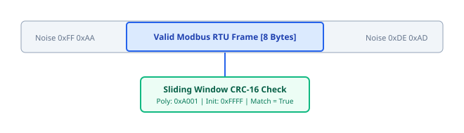

# 05. Dissectors and Compliance (fp-dissectors)

> **Topic:** Zero-panic protocol dissectors and standards compliance auditing.

---

## 1. Description

The `fp-dissectors` crate parses raw bytes from untrusted lines.  
It identifies Modbus RTU, Modbus TCP, CAN 2.0, CAN-FD, J1939, and CANopen.  
It validates frames against official protocol timing and framing rules.

---

## 2. Zero-Panic Rule

Industrial line noise creates malformed byte sequences.  
A dissector must never panic during execution.  
Engineers must follow these rules in parser paths:
- Never use `.unwrap()` or `.expect()`.
- Never use direct slice indexing `buf[i..j]`.
- Always use `nom` combinators or checked slice operations (`split_at_checked`).

---

## 3. Sliding-Window CRC Scanner

The scanner searches a noisy byte buffer for valid Modbus frames:

1. Test candidate sub-slices of length 4 to 256 bytes.
2. Verify the trailing 2 bytes against the computed Modbus RTU CRC-16.
3. When a match is found, extract the Application Data Unit (ADU).
4. Slide the window by one byte if the checksum fails.

---

## 4. Compliance Auditing

The compliance engine compares observed traffic with protocol standards:
- **Timing Violations:** Flags responses received before the minimum turnaround interval.
- **Protocol Violations:** Flags invalid function codes or incorrect byte counts.
- **Physical Link Health:** Measures CRC error percentage to detect faulty wiring.
