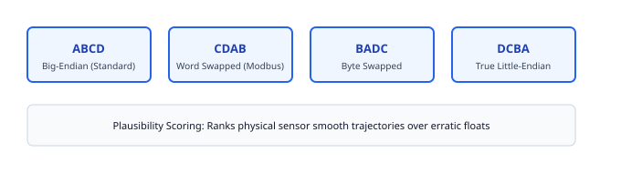

# 06. Register Inference Engine (fp-inference)

> **Topic:** Semantic register decoding and physical signal identification.

---

## 1. Description

Industrial field devices do not transmit data type schemas over the wire.  
A Modbus response contains only unformatted 16-bit registers.  
The `fp-inference` crate evaluates raw values across all common encodings.  
It identifies whether a register pair contains integer, floating-point, or ASCII data.

---

## 2. Multi-Representation Decoding

The decoder tests adjacent 16-bit registers across four word orders:

1. **ABCD (Big-Endian):** Standard IEEE 754 format.
2. **CDAB (Word-Swapped):** Most common Modbus floating-point encoding.
3. **BADC (Byte-Swapped):** Mid-big endian encoding.
4. **DCBA (Little-Endian):** True little-endian format.

---

## 3. Temporal Plausibility Scoring

The engine tracks register value changes over successive polling cycles across diverse industrial data types:

- **Float32 Representations:** Evaluates IEEE 754 across all four word orders (CDAB, ABCD, BADC, DCBA), penalizing NaN/Inf and astronomical exponents while rewarding smooth physical deltas.
- **Monotonic UInt32 Accumulators:** If successive 32-bit values increase monotonically ($\Delta \ge 0, \Delta \le 50000$), the engine scores the register at 0.95 confidence as an energy, flow, or hour totalizer.
- **Printable ASCII Strings:** If adjacent register bytes fall within the `0x20..=0x7E` range, the engine scores the register at 0.95 confidence as an equipment model, serial number, or firmware tag.
- **Fixed-Point Scaled Integers:** Detects standard industrial voltage ranges (`1900..=2600` with 0.1 scale = $190.0 \dots 260.0\text{ V}$), grid frequencies (`4950..=5050` with 0.01 scale = $49.50 \dots 50.50\text{ Hz}$), and signed temperatures (`-400..=1250` with 0.1 scale = $-40.0 \dots +125.0^\circ\text{C}$).
- **Mod10000 Energy Totalizers:** Recognizes cascaded modulo-10,000 meter pairs (`r1 * 10,000 + r0`) standard in European energy monitors.

---

## 4. Cryptographic Inspection & Payload Unmasking (fp-crypto)

The inference engine continuously computes the Shannon entropy of incoming Modbus responses and CAN/CAN-FD frames:

- **Shannon Entropy Detection:** Payloads exhibiting entropy $\ge 7.2\text{ bits/byte}$ or exceeding 92% of maximum possible theoretical entropy are flagged as encrypted or compressed.
- **KeyRing Auto-Decryption:** If operator encryption keys or XOR masks are registered in `KeyRing` for the node scope (e.g. `Modbus:Slave1` or `CAN:0x123`), the engine automatically decrypts or unmasks the payload before applying semantic decoders.
- **SecOC Verification:** Supports AUTOSAR SecOC message authentication using zero-dependency AES-128-CMAC (RFC 4493) to verify payload integrity and freshness counters.

---

## 5. Differential Capture with Automatic Ambient Noise Notching

When correlating physical control actions (switches, relays, valves) against bus signals:

- **Baseline Learning & Auto-Notching:** The session monitors ambient bus traffic before the operator actuates the device. Bits that oscillate on their own (analog noise, timestamps, rolling sequence counters) are automatically accumulated into a notch mask.
- **Delta Isolation:** When the operator flips the physical switch, the engine compares the current snapshot against baseline, bitwise-masking out all notched ambient bits (`active_diff = raw_diff & !notch_mask`).
- **Precision Pinpointing:** Only genuine bits directly caused by the physical actuation are emitted in the `DiffCaptureReport`.

---

## 6. CAN-FD Dual-Bitrate Load & 64-Byte Notching (ISO 11898-1:2015)

The inference engine fully supports Flexible Data-Rate (CAN-FD) traffic up to 64-byte payloads:

- **Dual-Bitrate Bus Load Modeling:** Computes wire bit-duration accounting for nominal arbitration phase (typically 500 kbps) and accelerated data phase (typically 2 Mbps or 5 Mbps). Applies ISO 11898-1:2015 CRC polynomials: 17-bit CRC for payloads $\le 16$ bytes and 21-bit CRC for payloads $20 \dots 64$ bytes, including fixed stuff bits and dynamic bit-stuffing approximation.
- **BRS & ESI Telemetry:** Captures Bit Rate Switch (`brs`) and Error State Indicator (`esi`) flags across all physical and replay frames.
- **64-Byte Sniffer & Differential Isolation:** `SnifferSlot` and `DiffCaptureSession` track full 64-byte arrays without heap reallocation, enabling real-time bitwise delta isolation and ambient noise notching across high-density automotive ECUs.

---

## 7. Vector CANdb++ (.dbc) Signal Importer

The `fp-inference` crate parses standard Vector CANdb++ (`.dbc`) database files to convert raw binary payloads into physical engineering values:

- **Message Declarations (`BO_`):** Identifies message arbitration IDs, distinguishing standard 11-bit IDs from extended 29-bit identifiers (indicated by bit 31 set in the DBC ID field).
- **Signal Extraction (`SG_`):** Decodes signals with Intel (little-endian) and Motorola (big-endian) byte ordering. Applies bit length extraction, sign extension for two's complement values, and linear scaling:
  $$\text{Physical Value} = (\text{Raw Integer} \times \text{Factor}) + \text{Offset}$$
- **Dynamic Signal Decoding:** The `DbcDatabase::extract_signals` method accepts incoming `CanFrame` structs and returns decoded `(SignalName, PhysicalValue)` tuples in real time.

---

## 8. AUTOSAR End-to-End (E2E) Functional Safety

The `fp-crypto` crate implements AUTOSAR E2E protection profiles to validate message integrity and detect sequence faults:

- **Profile 1 Protection:** Employs CRC-8 with polynomial `0x1D` (initial value `0xFF`, final XOR `0xFF`). Ingests 16-bit DataIDs (DataID low byte and DataID high byte) with a 4-bit sequence counter (`0..=14`).
- **Profile 2 Protection:** Employs CRC-8 SAE J1850 with polynomial `0x2F` (initial value `0xFF`, final XOR `0xFF`). Utilizes a 16-byte DataID array indexed by a 4-bit sequence counter (`0..=15`).
- **Counter Sequence Validation:** Tracks consecutive message counter values. Flags counter freezes, duplicate frames, and sequence jumps exceeding maximum allowed step size.
- **E2E Notch Masking:** The `generate_e2e_notch_mask` function creates a 64-byte bitmask targeting the exact byte offsets of the CRC and rolling counter. When analyzing vehicle bus traffic during physical actuation tests, the differential capture session applies this mask to eliminate rolling safety counter noise from physical signal correlation.

