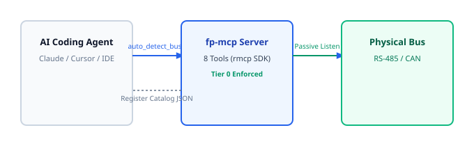

# 07. Model Context Protocol Tools (fp-mcp)

> **Topic:** The 9 core Model Context Protocol diagnostic and export tools for AI agents.

---

## 1. Description

The `fp-mcp` crate implements the Model Context Protocol (MCP) server.  
Autonomous AI agents (Claude, Cursor, Codex) connect to `field-probe` over stdio or SSE.  
Agents use tools to inspect hardware, identify buses, audit network health, and export SCADA configurations.

---

## 2. Interaction Sequence

The diagram below shows an agent discovering an unknown bus:



---

## 3. The 9 Core Diagnostic Tools

| Tool Name | Operation | Safety Tier |
|---|---|---|
| `list_dongles` | Enumerate connected adapters and active safety tiers | Tier 0 |
| `auto_detect_bus` | Run passive baud rate and protocol identification | Tier 0 |
| `get_bus_summary` | Return protocol, baud rate, framing, error rate, active nodes | Tier 0 |
| `get_register_catalog` | Return discovered registers, polling frequencies, inferred types | Tier 0 |
| `run_compliance_audit` | Audit captured frames against official timing standards | Tier 0 |
| `correlate_physical_change` | Isolate registers mutated during an operator physical action | Tier 0 |
| `load_security_key` | Register symmetric keys or certificates into KeyRing | Tier 0 |
| `request_active_probe` | Transmit safe read query on an idle bus (requires cryptographic permit and HMAC signature when operator key is loaded) | Tier 1 (Permit Required) |
| `export_bus_artifacts` | Export register catalog into Vector DBC, PCAP-NG, Telegraf, Node-RED, or JSON | Tier 0 |

---

## 4. Security & Cryptographic Enforcement

1. **Shared KeyRing:**  
   The MCP server shares its internal `KeyRing` handle directly with `InferenceEngine`.  
   When an AI agent registers a secret key via `load_security_key`, the inference engine immediately uses that key to decrypt high-entropy Modbus payloads and unpack engineering registers.

2. **Active Probe Signature Verification:**  
   When an operator secret key (`KeyType::OperatorSecret`) exists in `KeyRing`, `request_active_probe` mandates an HMAC cryptographic signature in the request parameters.  
   Requests lacking a valid signature fail immediately with a safety invariant violation.

---

## 5. Input Schemas

Each tool provides a strict JSON Schema:

```json
{
  "name": "export_bus_artifacts",
  "description": "Export the discovered register catalog and CAN signals into Vector DBC, Wireshark PCAP-NG, Telegraf Influx line protocol, Node-RED flow, or JSON.",
  "parameters": {
    "type": "object",
    "properties": {
      "interface_id": { "type": "string" },
      "format": {
        "type": "string",
        "enum": ["dbc", "pcapng", "telegraf", "json", "nodered"],
        "description": "Target export format"
      }
    },
    "required": ["format"]
  }
}
```

