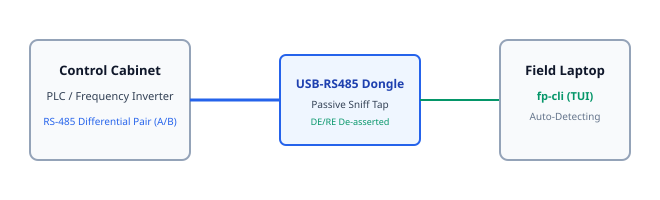

# 08. Field CLI and Workflows (fp-cli)

> **Topic:** Terminal user interface, field wiring diagnostic procedures, and telemetry artifact export.

---

## 1. Description

The `fp-cli` crate provides the native binary, full-screen Terminal User Interface (TUI), and artifact export workflows.  
Engineers use `fp` directly on a rugged field laptop without network access.  
The interface displays live bus load, framing errors, discovered registers, and allows instant SCADA/Wireshark export.

---

## 2. Cabinet Connection Topology

Connect the USB dongle to the differential communication pair in passive tap mode:



---

## 3. Step-by-Step Field Diagnostic Procedure

Follow these steps when diagnosing an unknown cabinet:

1. **Connect Hardware:**  
   Attach the USB-to-RS485 or USB-to-CAN dongle to the field laptop.  
   Attach the differential probe clips to the active bus lines (A and B, or CAN_H and CAN_L).

2. **Launch field-probe in Passive Mode:**  
   Execute the CLI binary:
   ```bash
   fp
   ```
   Verify the adapter status reports `SafetyTier::PassiveListenOnly`.

3. **Allow 10 Seconds for Auto-Lock:**  
   The engine scans candidate baud rates and bit-timings.  
   The engine locks automatically when CRC errors decrease to zero.

4. **Review Discovered Topology:**  
   Examine active node IDs, polling frequencies, and register values in the terminal table.

5. **Execute Compliance Audit:**  
   Review physical link warnings (e.g., termination resistor missing or wire polarity swapped).

6. **Export Field Artifacts:**  
   Generate standard configurations for PLC/SCADA systems:
   ```bash
   fp export --format dbc
   fp export --format pcapng
   fp export --format telegraf
   fp export --format nodered
   ```

---

## 4. Interactive Terminal Dashboard (TUI)

Executing `fp dashboard` launches the full-screen terminal user interface powered by `ratatui` and `crossterm`:

- **System Header:** Shows live version, safety tier status, Zero-TX verification, bus lock state, discovered register counts, active CAN nodes, and periodic broadcast loops.
- **Tab 1 — Register Catalog:** Real-time table of discovered Modbus holding registers, raw hex, polling frequency (Hz), jitter (ms), inferred data representation, and statistical confidence score.
- **Tab 2 — CAN Sniffer:** CAN bus monitor with bitwise XOR mutation tracking (`cansniffer` algorithm), DLC, payload, and periodic broadcast frequency detection.
- **Tab 3 — Compliance Audit:** Bus health score meter, total analyzed frames, CRC errors, protocol violations, and detailed diagnostic findings with physical wiring hints.
- **Tab 4 — Differential Capture:** Physical event correlation engine. Press `[d]` to snapshot baseline; toggle a switch or sensor on the field bus, then press `[d]` to stop and isolate exact bit mutations.

### Keyboard Shortcuts

| Key | Action |
|---|---|
| `[Tab]` / `[Right]` | Cycle forward to next view tab |
| `[BackTab]` / `[Left]` | Cycle backward to previous view tab |
| `[1]` .. `[4]` | Jump directly to View 1, 2, 3, or 4 |
| `[d]` / `[D]` | Toggle Physical Event Differential Capture |
| `[c]` / `[C]` | Reset / Clear Baseline Diff History |
| `[q]` / `[Esc]` | Exit Dashboard and restore terminal |
