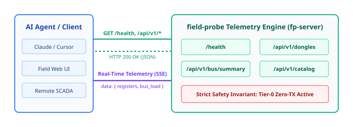

# 09. HTTP and WebSocket Telemetry API (fp-server)

> **Topic:** REST endpoints, Server-Sent Events (SSE) streaming, and SCADA artifact exports.

---

## 1. Description

The `fp-server` crate provides an asynchronous HTTP REST and real-time telemetry streaming interface.  
Engineers, dashboards, and AI agents can query link status, subscribe to live bus frames, and download register catalogs without terminal access.  
The server enforces the Tier-0 Zero-TX boundary across all endpoints.

---

## 2. Architecture Diagram

The diagram below shows the client communication architecture:



---

## 3. Endpoints Specification

### 3.1 Health Check (`GET /health`)

Returns system status and verifies that the safety invariant is active.

**Request:**
```http
GET /health HTTP/1.1
Host: localhost:8080
```

**Response (200 OK):**
```json
{
  "status": "ok",
  "version": "0.1.0",
  "uptime_seconds": 42,
  "safety_tier": "Tier-0: PassiveListenOnly",
  "zero_tx_enforced": true
}
```

---

### 3.2 Hardware Interfaces (`GET /api/v1/dongles`)

Returns connected USB and CAN adapters and their operational mode.

**Response (200 OK):**
```json
{
  "dongles": [
    {
      "interface_id": "usb-serial-port-0",
      "chip_type": "FtdiFt232",
      "description": "FTDI FT232R USB-to-RS485 Dongle",
      "supports_serial": true,
      "supports_can": false,
      "supports_listen_only": true,
      "current_tier": "Tier-0: PassiveListenOnly",
      "zero_tx_enforced": true
    }
  ]
}
```

---

### 3.3 Bus Summary (`GET /api/v1/bus/summary`)

Returns detected protocol parameters, active node count, and link health score.

**Response (200 OK):**
```json
{
  "protocol": "ModbusRtu",
  "baud_rate": 9600,
  "framing": "8N1",
  "total_registers": 14,
  "active_can_nodes": 0,
  "periodic_broadcast_loops": 0,
  "link_health_score": 0.99,
  "safety_tier": "Tier-0: PassiveListenOnly"
}
```

---

### 3.4 Live Register Map (`GET /api/v1/catalog`)

Returns discovered registers, polling frequencies, raw hex data, and inferred physical values.

**Response (200 OK):**
```json
{
  "total_entries": 1,
  "registers": [
    {
      "node_or_slave": "Slave-01",
      "address": 40001,
      "polling_frequency_hz": 10.0,
      "jitter_ms": 1.2,
      "raw_hex": "41 BB 99 9A",
      "plausible_type": "Float32_CDAB",
      "confidence": 0.98
    }
  ]
}
```

---

### 3.5 Real-Time Event Stream (`GET /api/v1/events/sse`)

Streams newly captured bus frames in real time over Server-Sent Events (SSE).

**Request:**
```http
GET /api/v1/events/sse HTTP/1.1
Host: localhost:8080
Accept: text/event-stream
```

**Stream Response (200 OK):**
```http
HTTP/1.1 200 OK
Content-Type: text/event-stream
Cache-Control: no-cache
Connection: keep-alive
Access-Control-Allow-Origin: *

: connected

data: {"interface_id":"can0","timestamp_us":1024000,"link_params":{"Can":{"bitrate":500000,"fd":false}},"payload":{"Can":{"id":{"Standard":456},"dlc":8,"data":[1,2,3,4,5,6,7,8],"is_fd":false,"is_rtr":false}},"direction":"Rx","error_flags":{"can_crc_error":false}}
```

---

### 3.6 SCADA Artifact Export (`GET /api/v1/export/{format}`)

Exports the active register catalog and signals directly into standard SCADA configurations:
- `GET /api/v1/export/dbc` — Vector CAN database definition
- `GET /api/v1/export/pcapng` — Wireshark network trace
- `GET /api/v1/export/telegraf` — InfluxDB Line Protocol
- `GET /api/v1/export/nodered` — Node-RED IoT gateway flow
- `GET /api/v1/export/json` — JSON register catalog
