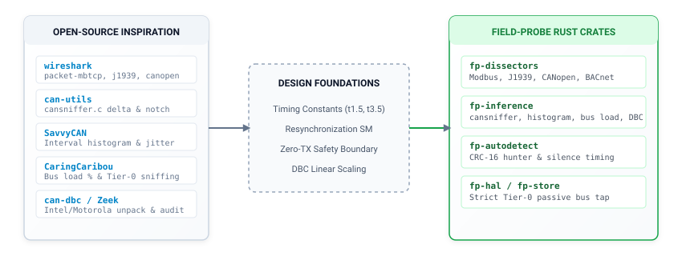

# Open-Source Foundations & Algorithm Inspiration

> **Topic:** Industrial protocol reference algorithms and architecture inspiration.

---

## 1. Architectural Foundations



`field-probe` builds upon battle-tested industrial networking patterns and algorithm designs:

| Reference Project | Domain | Architecture Role & Algorithm Inspiration | Pure Rust Target Module |
|---|---|---|---|
| **Wireshark** | Packet Dissectors | Query/response transaction pairing, diagnostic sub-function codes | `fp-dissectors::modbus`, `j1939`, `canopen`, `bacnet` |
| **linux-can / can-utils** | CAN CLI Utilities | Volatile bit-level delta tracking, notch filtering, hold-decay timers | `fp-inference::sniffer` |
| **CaringCaribou** | Automotive Security | Passive arbitration ID discovery, non-intrusive bus load calculation | `fp-inference::bus_load` |
| **SavvyCAN** | CAN Diagnostics | Inter-arrival timing histograms, periodic broadcast loop detection | `fp-inference::histogram`, `signals` |
| **Zeek ICSNPP** | ICS Anomaly Parsing | Standards compliance checks, unauthorized command detection | `fp-dissectors::compliance` |
| **tokio-modbus** | Async Rust Modbus | Clean async framing codecs and PDU serialization | `fp-hal::replay` |
| **rodbus** | Deterministic Modbus | Protocol state machine validation and robust timeout handling | `fp-autodetect::serial_hunter` |
| **socketcan-rs** | Linux SocketCAN | Native asynchronous Linux CAN socket integration | `fp-hal::socketcan` |
| **can-dbc** | CAN Database Parser | Motorola & Intel bitfield unpacking with linear scale factors | `fp-inference::signals` |

---

## 2. Dissection Architecture Inspired by Wireshark (`packet-mbtcp.c`)

### 2.1 Packet Classification Algorithm
Wireshark separates interleaved traffic on a bus into three categories:

```c
#define QUERY_PACKET     0
#define RESPONSE_PACKET  1
#define CANNOT_CLASSIFY  2
```

In `field-probe`, the passive listener classifies packets using the following rules:
1. If the function code has the highest bit set (`FC >= 0x80`), classify as an **Exception Response**.
2. If the frame is followed within $t_{3.5}$ to $t_{\text{timeout}}$ by a message with the same Slave ID and matching function code, pair them as **Query & Response**.
3. If a packet has Function Code `0x01`..`0x04` with a 16-bit register count, classify as a **Query**.
4. If a packet has Function Code `0x01`..`0x04` with an 8-bit byte count (`ByteCount == 2 * Count`), classify as a **Response**.

### 2.2 Diagnostic Sub-Function Table (FC 0x08)
When observing diagnostic queries on Modbus line taps:

| Sub-Function | Name | Description |
|---|---|---|
| `0x0000` | Return Query Data | Echo test; response echoes query bytes |
| `0x0001` | Restart Communications | Clears diagnostic registers; restarts port |
| `0x0002` | Return Diagnostic Register | Returns controller diagnostic word |
| `0x0004` | Force Listen-Only Mode | Commands slave into passive listen-only mode |
| `0x000A` | Clear Counters | Resets all communication error counters to zero |
| `0x000B` | Return Bus Message Count | Returns total frame count observed by node |
| `0x000C` | Return Bus Comm Error Count | Returns CRC and parity error count |
| `0x000D` | Return Exception Error Count | Returns exception response count |
| `0x000E` | Return Slave Message Count | Returns messages addressed to this slave |
| `0x000F` | Return Slave No-Response Count | Returns broadcast or unanswered queries |

---

## 3. Real-Time Delta Tracking Inspired by `cansniffer`

From the proven `cansniffer` design, `field-probe` implements the volatile bit-level delta highlighter in `fp-inference::sniffer`:

### 3.1 Data Structure
```rust
pub struct SnifferSlot {
    pub can_id: CanId,
    pub last_data: [u8; 8],
    pub current_data: [u8; 8],
    pub dlc: usize,
    pub marker: [u8; 8],   // Mutated bits (current ^ last)
    pub notch: [u8; 8],    // Suppressed noisy bits (rolling counters)
    pub hold_ticks: u32,   // Visual persistence timer
    pub frame_count: u64,
}
```

### 3.2 Delta and Notch Filtering Procedure
1. Receive incoming frame for CAN ID.
2. Compute raw bitwise change:  
   $$\text{delta} = \text{current.data} \oplus \text{last.data}$$
3. Apply notch filter to remove known high-frequency counter bytes:  
   $$\text{active\_delta} = \text{delta} \ \& \ (\sim\text{notch})$$
4. If $\text{active\_delta} \neq 0$:
   - Set visual persistence counter (`hold_ticks = 100`).
   - Trigger MCP event notification (`correlate_physical_change`).
5. Update stored state: `last_data = current_data`.

---

## 4. CAN Timing & Jitter Estimation Inspired by `SavvyCAN`

Implemented in `fp-inference::histogram`:
- **Periodic Transmission Histogram:**  
  Calculate $\Delta t = t_n - t_{n-1}$ for each unique arbitration ID.  
  Track mean and variance using Welford's single-pass algorithm.  
  Group intervals into discrete timing bins (10ms, 20ms, 50ms, 100ms, 250ms, 1000ms).  
  Nodes with standard deviations under 5% indicate periodic broadcast loops (e.g. engine RPM, inverter state).
- **Signal Unpacking (`fp-inference::signals`):**  
  Extract Motorola (Big-Endian) and Intel (Little-Endian) bitfields spanning byte boundaries:
  $$\text{Engineering Value} = (\text{Raw Integer} \times \text{Factor}) + \text{Offset}$$

---

## 5. Non-Intrusive Bus Discovery Inspired by `CaringCaribou`

Implemented in `fp-inference::bus_load`:
- **Tier-0 Passive Listener:** Sniffs all 11-bit standard IDs (`0x000`..`0x7FF`) and 29-bit extended IDs. Tracks bus load percentage:
  $$\text{Bus Load (\%)} = \frac{\sum (\text{Frame Bit Length})}{\text{Nominal Bitrate} \times \text{Sample Window}} \times 100\%$$
- Standard CAN 2.0 frames allocate 47 fixed/overhead bits plus $8 \times \text{DLC}$ data bits and bit-stuffing overhead.
- Extended frames allocate 67 fixed/overhead bits plus $8 \times \text{DLC}$ data bits and bit-stuffing overhead.

---

## 6. Standards Compliance Engine Inspired by `Zeek ICSNPP`

Implemented in `fp-dissectors::compliance`:
- Flags unauthorized Function Code execution (e.g. Write Multiple Registers `0x10` sent to a sensor-only node).
- Flags truncated responses where byte count does not match register transfer quantity:
  $$\text{ByteCount} \neq 2 \times \text{Quantity}$$
- Flags address boundary violations where `start_address + quantity > 65536`.
- Flags illegal coil values not equal to `0x0000` or `0xFF00`.

---

## 7. Verification Status in Pure Rust

All referenced algorithms have comprehensive unit tests in the Rust workspace:

| Crate | Module | Test Function | Status |
|---|---|---|---|
| `fp-dissectors` | `modbus.rs` | `test_parse_valid_read_holding_registers_query`, `test_parse_diagnostics_frame`, `test_parse_modbus_exception_frame` | **PASSED** |
| `fp-dissectors` | `j1939.rs` | `test_j1939_header_pdu1_destination_specific`, `test_j1939_eec1_dissection` | **PASSED** |
| `fp-dissectors` | `canopen.rs` | `test_canopen_heartbeat_dissection`, `test_canopen_nmt_command`, `test_canopen_sdo_upload` | **PASSED** |
| `fp-dissectors` | `bacnet.rs` | `test_bacnet_token_frame` | **PASSED** |
| `fp-dissectors` | `compliance.rs` | `test_modbus_register_overflow_compliance`, `test_modbus_exception_compliance` | **PASSED** |
| `fp-inference` | `sniffer.rs` | `test_cansniffer_delta_and_notch` | **PASSED** |
| `fp-inference` | `histogram.rs` | `test_savvycan_periodic_rate_detection` | **PASSED** |
| `fp-inference` | `bus_load.rs` | `test_standard_frame_bit_calculation`, `test_bus_load_estimation_report` | **PASSED** |
| `fp-inference` | `signals.rs` | `test_intel_signal_unpacking`, `test_signed_temperature_unpacking` | **PASSED** |
| `fp-autodetect` | `serial_hunter.rs` | `test_timing_intervals_for_high_baud`, `test_sliding_window_modbus_resynchronization` | **PASSED** |
